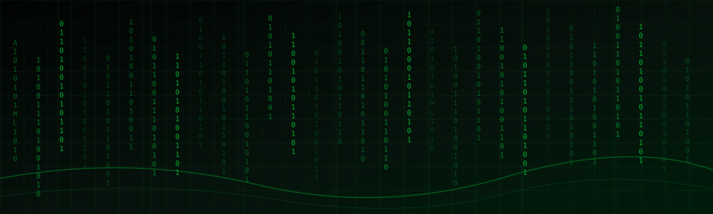
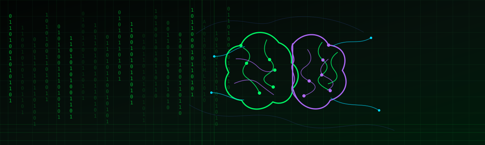
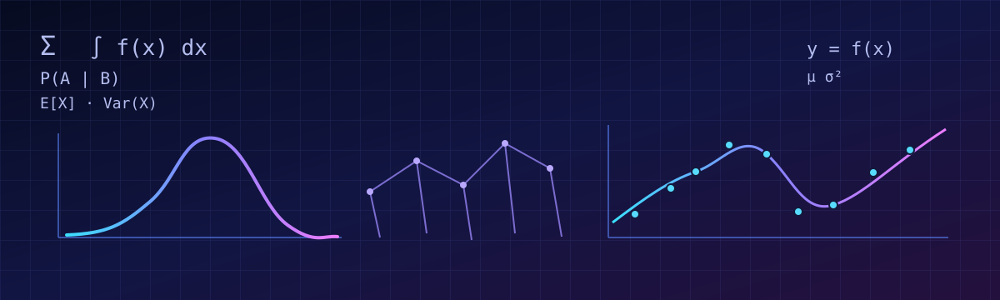
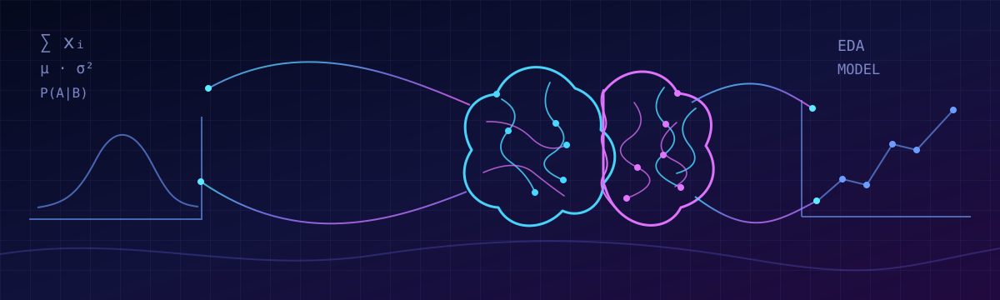
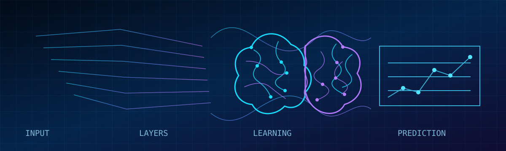
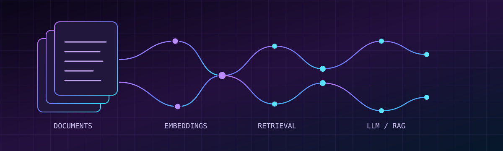
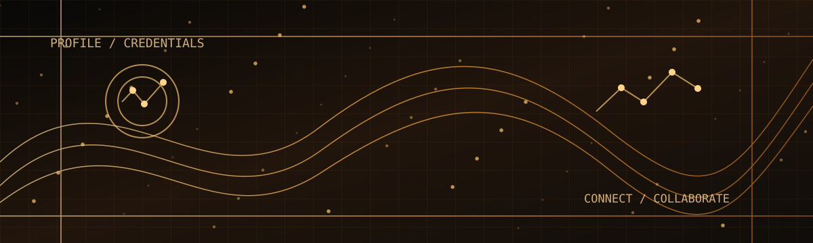

<!-- Tarun Singh | Multi-theme animated GitHub profile -->

<div align="center">

<!-- THEME 1: MATRIX GREEN — profile identity -->
<p align="center"></p>

<h1>⌁ TARUN SINGH ⌁</h1>

<a href="https://readme-typing-svg.demolab.com/">
  
</a>

<br/>

<a href="./assets/Tarun_Singh_Resume.pdf"></a>
<a href="https://github.com/Tarunsingh465?tab=repositories"></a>
<a href="mailto:ts12242005@gmail.com"></a>

<br/><br/>


</div>

---

## `~/quick-navigation`

Jump to a section, open the expandable panels, or use the resume button above.

<div align="center">

<a href="#profile"></a>
<a href="#maths"></a>
<a href="#datascience"></a>
<a href="#aiml"></a>
<a href="#genai"></a>
<a href="#engineering"></a>
<a href="#about"></a>

</div>

> **The design has distinct visual modes:** Matrix green for the profile, violet-blue for Data Science, indigo-cyan for mathematics and statistics, electric blue for AI/ML, purple for GenAI, and copper-gold for personal information.

---

<a id="profile"></a>
## `01 // PROFILE` — Matrix terminal

<p align="center">
  
</p>

```text
USER       : Tarun Singh
ROLE       : B.Tech Computer Science (Data Science) student
INTERESTS  : Data Science, AI/ML, Deep Learning, Generative AI
FOUNDATION : Mathematics, probability, statistics and computational thinking
MINDSET    : Learn deeply. Evaluate carefully. Build responsibly.
```

I'm a Computer Science (Data Science) student interested in the reasoning behind intelligent systems—not just using libraries, but understanding data, mathematical ideas, model behavior, and evaluation. I enjoy building my foundations across analytics, machine learning, deep learning, LLM applications, and practical software engineering.

<div align="center">

<a href="https://github.com/Tarunsingh465"></a>
<a href="https://github.com/Tarunsingh465?tab=repositories"></a>

</div>

---

<a id="maths"></a>
## `02 // MATHEMATICS, PROBABILITY & STATISTICS`

<p align="center">
  
</p>

<p align="center">
  
  
  
</p>

> **Data Science is mathematical thinking applied to evidence.** I focus on strengthening the math and statistics that explain how data and models behave.

<details open>
<summary><b>Linear algebra — representations and transformations</b></summary>

- Scalars, vectors, matrices and multidimensional arrays
- Vector operations, dot products, matrix multiplication and transposes
- Vector norms, distances and geometric intuition
- Eigenvalues and eigenvectors
- Tensor products and complex-vector representations
- Implementing vector and matrix operations with Python and NumPy

*Where it connects:* feature representations, embeddings, neural-network computations, dimensionality reduction and quantum-computing foundations.

</details>

<details>
<summary><b>Probability — reasoning under uncertainty</b></summary>

- Events, sample spaces and probability rules
- Conditional probability, independence and Bayes' theorem
- Random variables and probability distributions
- Expected value, variance and standard deviation
- Joint, marginal and conditional distributions
- Sampling intuition and the Central Limit Theorem

*Where it connects:* probabilistic prediction, uncertainty, classification, sampling and Bayesian reasoning.

</details>

<details>
<summary><b>Statistics — extracting evidence from data</b></summary>

- Mean, median, quantiles, variance and standard deviation
- Data distributions, skewness, outliers and variability
- Exploratory analysis, correlation and relationships between variables
- Sampling, parameter estimation and confidence intervals
- Hypothesis testing, p-values and statistical significance
- Regression interpretation and residual analysis

*Where it connects:* data quality, experiment analysis, feature investigation, model evaluation and communicating findings responsibly.

</details>

<details>
<summary><b>Calculus & optimization — how models improve</b></summary>

- Functions, derivatives, partial derivatives and gradients
- Chain-rule intuition and the role of backpropagation
- Loss functions, gradient-based optimization and learning rates
- Regularization, convergence and overfitting
- Numerical optimization with SciPy

*These are mathematical foundations I continue to develop and connect to practical model training.*

</details>

---

<a id="datascience"></a>
## `03 // DATA SCIENCE` — From raw data to useful insight

<p align="center">
  
</p>

<p align="center">
  
  
  
</p>

<details open>
<summary><b>Data handling & exploration</b></summary>

- Data cleaning, preprocessing and missing-value handling
- Categorical data transformation and feature preparation
- Exploratory Data Analysis (EDA)
- Descriptive statistics and distribution analysis
- Visualization and communicating patterns with Matplotlib and Seaborn
- Using Pandas and NumPy for practical analysis

</details>

<details>
<summary><b>My data-science workflow</b></summary>

`Question → Collect → Clean → Explore → Analyze → Engineer Features → Model → Validate → Communicate`

I aim to understand dataset quality and assumptions before drawing conclusions from an analysis or model.

</details>

<div align="center">


</div>

---

<a id="aiml"></a>
## `04 // ARTIFICIAL INTELLIGENCE & MACHINE LEARNING`

<p align="center">
  
</p>

<details open>
<summary><b>Machine Learning</b></summary>

- Supervised and unsupervised learning foundations
- Regression, classification, trees and Random Forest
- Feature engineering and preprocessing
- Train / validation / test splits and cross-validation
- Hyperparameter tuning and model selection
- Overfitting, generalization and error analysis
- Anomaly-detection concepts

</details>

<details open>
<summary><b>Evaluation, validation & statistical discipline</b></summary>

- Confusion matrices, precision, recall, F1-score and accuracy
- Balanced accuracy and class-imbalance considerations
- ROC curves, ROC-AUC, precision-recall curves and average precision
- Threshold selection and metric trade-offs
- Stratified validation and robust evaluation practices

**My principle:** a model's score matters, but so do the split strategy, metric choice, class balance, and errors the model makes.

</details>

<details>
<summary><b>Deep learning</b></summary>

- Neural networks and multilayer perceptrons
- Convolutional Neural Networks (CNNs)
- Recurrent Neural Networks (RNNs) and LSTMs
- Autoencoders and anomaly-detection approaches
- Transformer architectures and attention
- Loss functions, optimization, backpropagation and validation
- Computer vision fundamentals with OpenCV

</details>

<div align="center">


</div>

---

<a id="genai"></a>
## `05 // GENERATIVE AI` — LLMs, retrieval & context

<p align="center">
  
</p>

<p align="center">
  
  
  
</p>

<details open>
<summary><b>LLM application building blocks</b></summary>

- Large Language Model (LLM) integration and prompt engineering
- Retrieval-Augmented Generation (RAG)
- Document ingestion, extraction, chunking and metadata handling
- Embeddings and semantic similarity retrieval
- Vector databases and retrieval pipelines
- Context-grounded answers and document-level filtering
- LangChain, LangGraph and Hugging Face
- LLM APIs and conversational application integration

</details>

<div align="center">


</div>

---

<a id="engineering"></a>
## `06 // SOFTWARE ENGINEERING & MLOPS`

<div align="center">


</div>

| Area | Stack / concepts |
|---|---|
| Programming | Python, SQL |
| Data work | Pandas, NumPy, Matplotlib, Seaborn, SciPy |
| APIs & apps | FastAPI, Flask, Streamlit, API integration |
| Databases | PostgreSQL, MySQL, SQLAlchemy, query optimization |
| MLOps foundations | MLflow, model deployment concepts, Docker basics |
| Workflow | Git, GitHub, VS Code, Jupyter Notebook |
| Developer AI tools | GitHub Copilot, Claude Code, Antigravity |

<details>
<summary><b>Additional technical interests</b></summary>

- Cybersecurity and ML-based intrusion-detection concepts
- Explainable AI and model monitoring concepts
- Linux and command-line fundamentals
- Linear algebra and computational concepts for quantum computing

</details>

---

<a id="about"></a>
## `07 // ABOUT, CREDENTIALS & CONTACT`

<p align="center">
  
</p>

<table>
<tr><td><b>Education</b></td><td>B.Tech, Computer Science (Data Science) — IPS Academy, Indore</td></tr>
<tr><td><b>Graduation</b></td><td>Expected 2027</td></tr>
<tr><td><b>Training</b></td><td>Software Engineering Trainee & Quantum Engineer — AlphaInfo Lab</td></tr>
<tr><td><b>Experience</b></td><td>Data Science Intern — Alfido Tech (May–July 2026)</td></tr>
<tr><td><b>Certifications</b></td><td>Python and Data Science training; Python and SQL certification through IIT Bombay Spoken Tutorial</td></tr>
<tr><td><b>Beyond tech</b></td><td>Co-author of the Hindi poetry anthology <i>Abhivyakti</i>; Vice President of the Poetry Club</td></tr>
</table>

<div align="center">

<a href="./assets/Tarun_Singh_Resume.pdf"></a>
<a href="mailto:ts12242005@gmail.com"></a>
<a href="https://github.com/Tarunsingh465"></a>

</div>

---

## `08 // LIVE GITHUB TELEMETRY`

<div align="center">

<a href="https://github.com/Tarunsingh465">

</a>
<a href="https://github.com/Tarunsingh465">

</a>

<br/><br/>


<br/><br/>


</div>

<sub>GitHub statistics and external image widgets can be delayed or temporarily unavailable. They reflect data those services can access; they are not academic grades or measures of model performance.</sub>

---

<div align="center">

### `while (alive) { learn(); build(); improve(); }`


**Understand the mathematics. Respect the data. Engineer the intelligence.**

<a href="#profile">↑ Back to the top</a>

</div>
